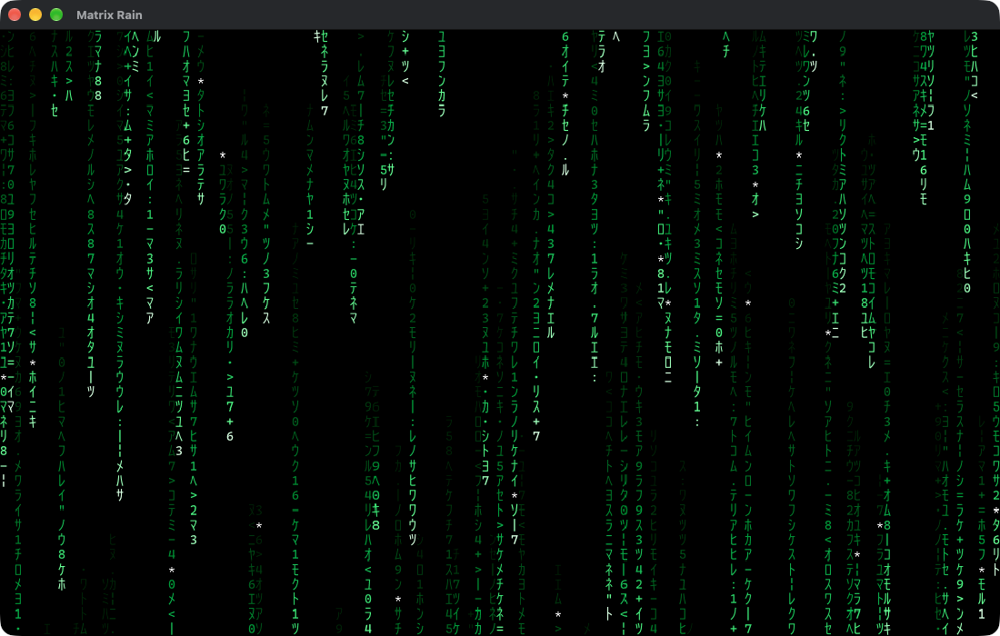
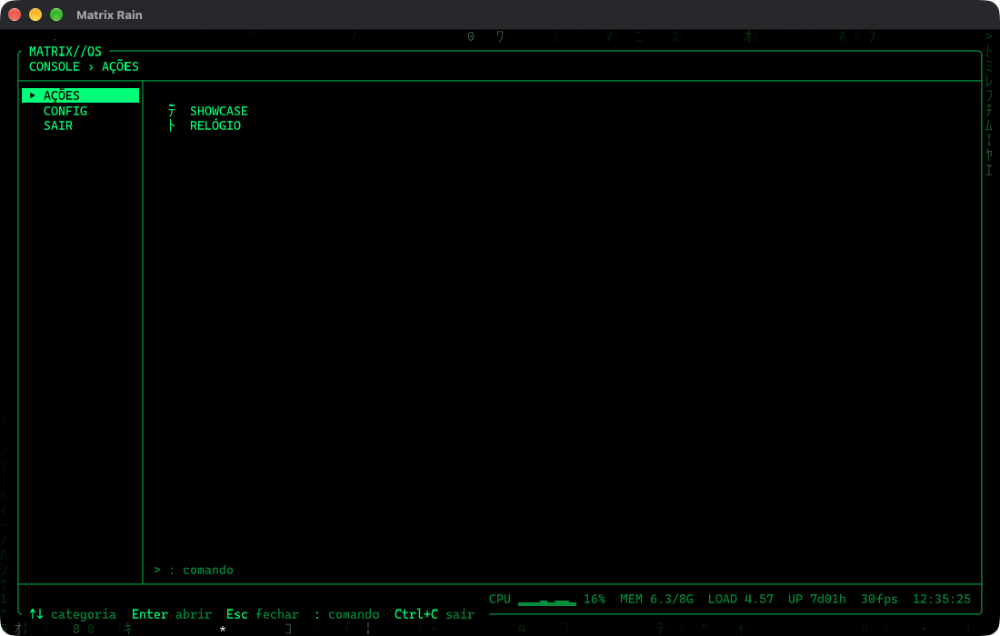
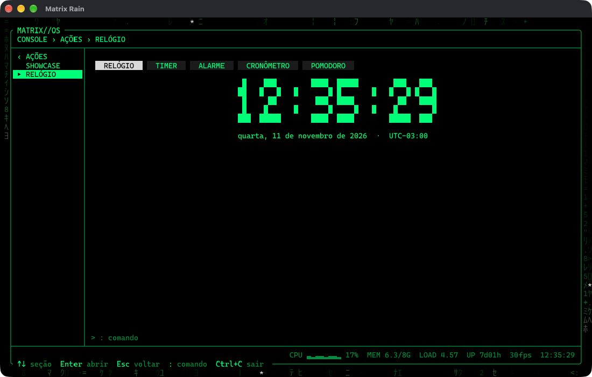
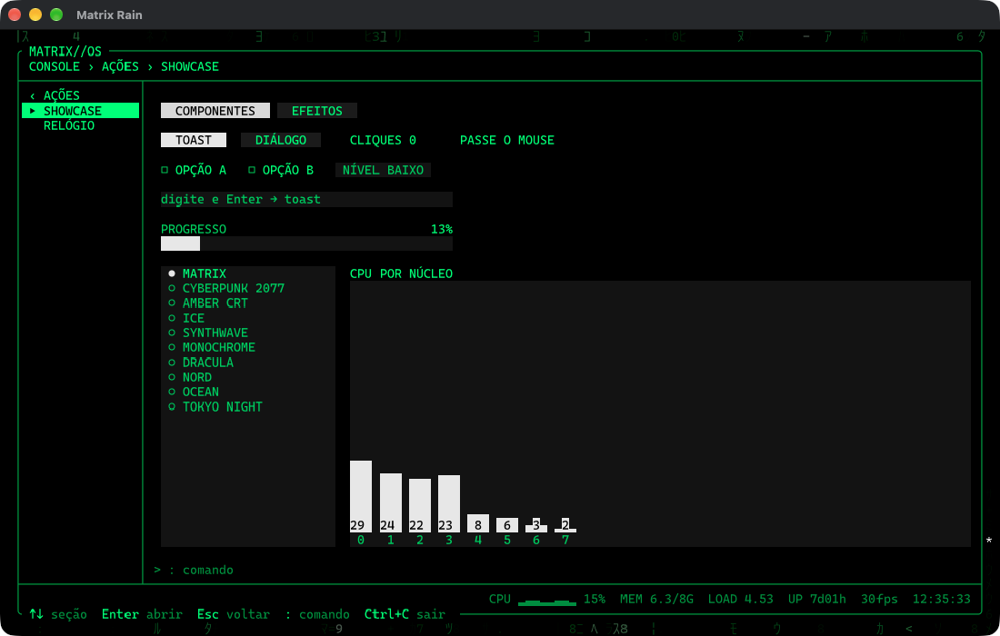
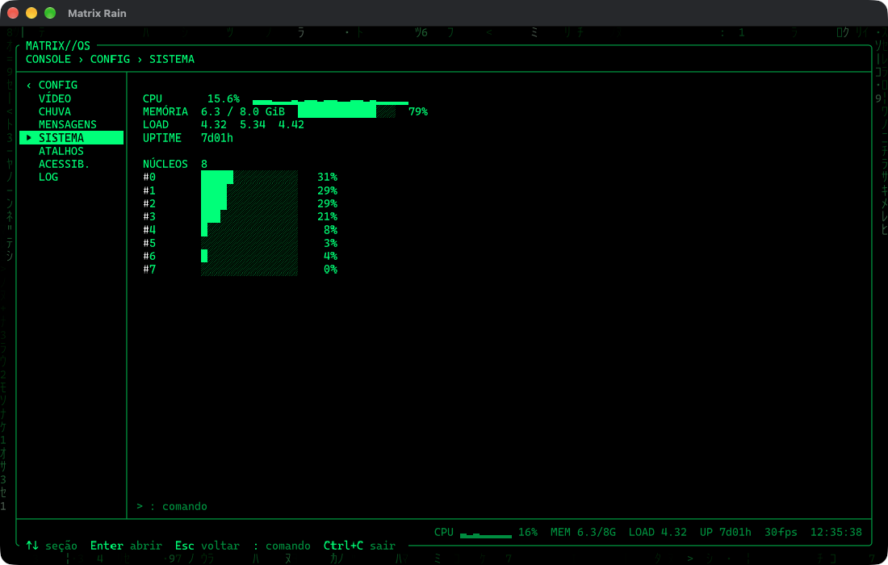
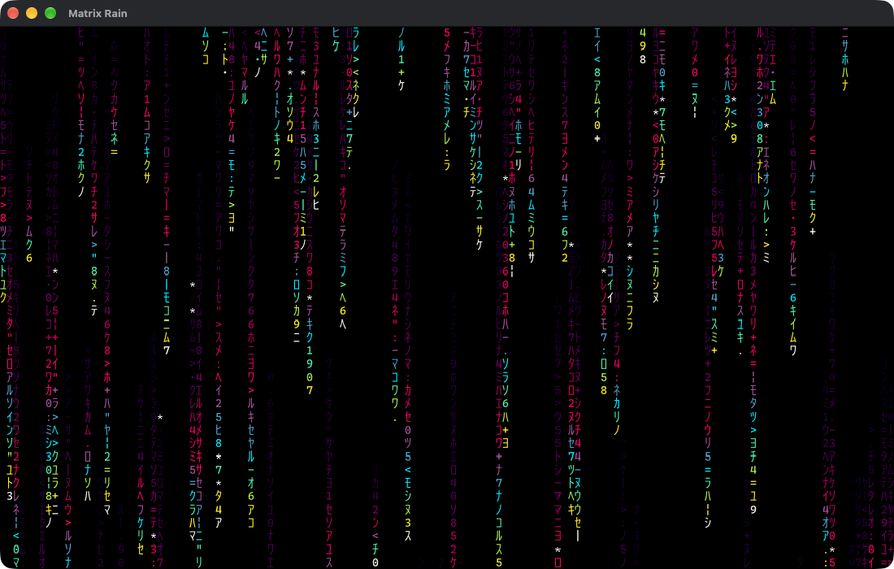

# matrix-rain

Chuva digital estilo *Matrix* no terminal, escrita em Rust com [ratatui](https://ratatui.rs). Por cima da chuva há um console (MATRIX//OS) com menus de configuração, um relógio (timer, alarme, cronômetro, pomodoro) e uma vitrine de componentes e efeitos. Funciona com teclado e mouse.

Bibliotecas de UI: [ratcn](https://github.com/kristoferlund/ratcn) (componentes com foco, mouse e hover: botões, abas, listas, campos, diálogos, toasts) e [tachyonfx](https://github.com/ratatui/tachyonfx) (efeitos de transição).



| Console | Relógio |
|---|---|
|  |  |
| **Showcase** | **Sistema** |
|  |  |

Tema CYBERPUNK 2077:



## Requisitos

- Rust (edition 2021) e Cargo
- Terminal com suporte a cores *true color* (24 bits) e a caracteres Unicode (katakana half-width)

## Como rodar

```sh
cargo run --release
```

Ou compile e execute o binário:

```sh
cargo build --release
./target/release/matrix-rain
```

Atalhos no `Makefile`: `make run`, `make dev`, `make build`, `make check`, `make test`, `make fmt`, `make lint`, `make clean`, `make install`, `make desktop`, `make bundle`.

O perfil `release` já vem otimizado (LTO, `codegen-units = 1`, `panic = "abort"`, binário sem símbolos).

## Versão desktop

Com a feature `desktop`, o mesmo app roda numa janela nativa desenhada por GPU ([ratatui-wgpu](https://crates.io/crates/ratatui-wgpu) + winit), sem precisar de terminal. O build padrão não muda: as dependências de GPU só entram com a feature.

```sh
cargo run --release --features desktop -- --window   # ou: make desktop
```

O binário com a feature abre a janela quando não está num terminal (duplo clique, `.app`) ou com `--window`; `--tty` força o modo terminal. Fechar a janela pelo botão do sistema sai direto (a trava com código vale para o teclado).

Para empacotar (`.app` no macOS, `.msi` no Windows, `.deb` no Linux) com [cargo-bundle](https://github.com/burtonageo/cargo-bundle):

```sh
cargo install cargo-bundle
make bundle   # cargo bundle --release --features desktop
```

No Windows, a versão desktop é compilada sem janela de console (`windows_subsystem = "windows"`).

**Fontes** (embutidas no binário, subconjuntos gerados com `pyftsubset`, em `assets/fonts/`): [Cascadia Mono](https://github.com/microsoft/cascadia-code) para latim, setas, molduras e blocos, e [BIZ UDGothic](https://github.com/googlefonts/morisawa-biz-ud-gothic) para o katakana half-width (1 célula de largura). Ambas sob a SIL Open Font License 1.1 (`assets/fonts/*-OFL.txt`).

## Controles

A chuva sozinha é o modo **Idle**. Nele valem os atalhos de uma tecla:

| Tecla | Ação |
|-------|------|
| `Enter` / `F1` | Abrir o console |
| `:` | Abrir o console direto na linha de comando |
| `q` / `Esc` / `Ctrl+C` | Abrir a trava de saída: digite `matrix` e `Enter` para sair (`Esc` cancela, código errado limpa o campo) |
| `Espaço` / `p` | Pausar / continuar |
| `+` / `=` / `↑` | Aumentar velocidade (até 8x) |
| `-` / `_` / `↓` | Diminuir velocidade (até 0.1x) |
| `t` / `→` / `Tab` | Próximo tema |
| `T` / `←` / `Shift+Tab` | Tema anterior |
| `1`–`9`, `0` | Escolher tema diretamente (`0` = 10º tema) |
| `f` / `F11` | Alternar entre tela cheia e modo janela (com moldura) |
| `w` | Mostrar uma mensagem escondida agora |
| `h` | Mostrar / esconder o HUD (tema, velocidade, FPS) |
| `r` | Reiniciar a chuva |

No **console** a chuva continua ao fundo, atenuada. A barra lateral tem três itens: **AÇÕES**, **CONFIG** e **SAIR**. `↑↓` escolhe, `Enter` abre o submenu (ou a página, em SAIR), `↑↓` escolhe a seção, `Enter` entra na página, `↑↓` escolhe o item, `←→`/`Enter` ajusta (a chuva muda na hora) e `Esc` volta um nível até fechar o console. Nas páginas de AÇÕES, `Tab` passa de um controle para o outro. `:` foca a linha de comando. `Ctrl+C` ou a página **SAIR** abrem a trava. Depois de 60 s sem tecla o console se fecha sozinho (a menos que haja texto na linha de comando).

Menus:

- **AÇÕES**: **SHOWCASE** (vitrine) e **RELÓGIO**.
- **CONFIG**: **VÍDEO** (tema, velocidade, tela cheia, HUD), **CHUVA** (rastro, densidade, pausar, reiniciar), **MENSAGENS** (automáticas, intervalo, mostrar agora), **SISTEMA**, **ATALHOS** (mapa de teclas), **ACESSIB.** (reduzir movimento = sem troca de caracteres nos rastros, sem animações e sem efeitos; alto contraste) e **LOG** (eventos recentes).
- **SAIR**.

### Mouse

No terminal e na janela desktop. No Idle, um clique abre o console. No console, clique na barra lateral escolhe e abre (`‹ GRUPO` volta), a roda percorre as seções, clique na linha de comando foca o prompt. Nas páginas de ajuste, clique num item age como `Enter`; em sliders e escolhas, a metade esquerda diminui e a direita aumenta. Nas páginas de AÇÕES, botões, abas, caixas, listas e campos respondem a clique, hover e roda.

### SHOWCASE

Duas abas. **COMPONENTES** mostra os componentes do ratcn funcionando: botões (um abre um toast, outro um diálogo modal, outro conta cliques), tooltip no hover, caixas de seleção, `Cycle`, campo de texto (Enter vira toast), barra de progresso, lista de temas (escolher aplica o tema) e gráfico de CPU por núcleo. **EFEITOS** lista efeitos do tachyonfx (coalesce, dissolve, sweep, slide, fade, HSL shift, explode, evolve, expand, stretch, glitch, darken, sequência); escolher um toca o efeito numa amostra.

### RELÓGIO

Cinco modos, em abas (clique ou `←→`):

- **RELÓGIO**: hora local em dígitos grandes e a data por extenso.
- **TIMER**: iniciar/pausar, zerar, ±1 min e um campo para a duração (`5m`, `90s`, `1h30m`). Ao terminar: toast e um flash na tela.
- **ALARME**: hora (`HH:MM`, hora local) e liga/desliga. Toca mesmo com o console fechado: `Enter`/`Esc`/`Espaço` ou clique desligam, `s` adia 5 min.
- **CRONÔMETRO**: iniciar/pausar, voltas (com o parcial de cada uma) e zerar.
- **POMODORO**: foco e pausas (pausa longa a cada 4 sessões), com as durações ajustáveis. Cada troca de fase dá toast e flash.

Os contadores continuam rodando com o console fechado. Ao abrir a página ou trocar de modo, a área começa coberta de katakana da chuva, que se dissolve (`fx::dissolve`) revelando o relógio. Os dígitos que mudam "assentam" com um efeito (`fx::coalesce`). As durações e o alarme são salvos na hora em `config.toml` (seção `[clock]`).

## Configuração

Tudo muda ao vivo. Nas páginas de ajuste, **APLICAR** salva, **DESCARTAR** volta ao estado de quando o console abriu (ou do último Aplicar) e **PADRÕES** (Enter duas vezes) volta aos valores de fábrica sem salvar. O breadcrumb mostra `● alterações` enquanto houver algo não aplicado.

O arquivo é `config.toml` no diretório de configuração do SO (`~/.config/matrix-rain/` no Linux, `~/Library/Application Support/matrix-rain/` no macOS). Campos ausentes usam o padrão; arquivo inválido é ignorado (padrões) e registrado no LOG.
A página **SISTEMA** mostra CPU (total, histórico e por núcleo), memória, load average e uptime. O rodapé do console mostra o resumo (CPU com sparkline, MEM, LOAD, UP, FPS e relógio na hora local); o que não cabe na largura some por ordem de prioridade.

### Linha de comando

`:` abre o prompt. `Tab` completa o comando e o argumento (temas, páginas), `↑↓` percorre o histórico da sessão e a saída ou o erro aparece logo acima do prompt.

| Comando | Ação |
|---------|------|
| `theme <n\|nome>` | Troca o tema (`theme 7`, `theme dracula`) |
| `speed <x>` | Velocidade da chuva (`speed 1.5`) |
| `pause`, `fullscreen` (`fs`), `hud`, `msg`, `restart` | Mesmo que os atalhos do Idle |
| `open <página>` | Abre uma página (`open system`, `open clock`, `open showcase`) |
| `clock [modo]` | Abre o RELÓGIO (`relogio`, `timer`, `alarme`, `cronometro`, `pomodoro`) |
| `timer [5m\|90s\|1h30m\|pause\|reset]` | Inicia / pausa / zera o timer; sem argumento, abre o modo |
| `alarm [HH:MM\|off]` | Liga o alarme (hora local) ou desliga |
| `stopwatch [start\|lap\|reset]` (`sw`) | Cronômetro |
| `pomodoro [start\|skip\|reset]` (`pomo`) | Pomodoro |
| `help [comando]`, `clear` | Ajuda / limpa a linha de mensagens |
| `exit` (`quit`, `q`) | Abre a trava de saída |

## Temas

1. **MATRIX** — verde clássico
2. **CYBERPUNK 2077** — amarelo, ciano e magenta
3. **AMBER CRT** — âmbar de monitor antigo
4. **ICE** — azul gelo
5. **SYNTHWAVE** — roxo e rosa neon
6. **MONOCHROME** — tons de cinza
7. **DRACULA** — roxo e rosa sobre fundo escuro
8. **NORD** — azuis árticos
9. **OCEAN** — azuis oceânicos com cabeça creme ([paleta](https://colorhunt.co/palette/0862884d8dba97d7ffffefc4))
10. **TOKYO NIGHT** (tecla `0`) — azul e lilás noturno

## Mensagens escondidas

De tempos em tempos (a cada 5 minutos por padrão, ajustável em MENSAGENS, ou ao apertar `w`) uma mensagem em letras grandes é pintada pela própria chuva: cada rastro que passa por uma célula da letra deixa ali o seu caractere, que fica parado e brilhante. Com a mensagem completa, ela fica alguns segundos na tela e depois os rastros seguintes vão lavando as letras até a chuva voltar ao normal. Só uma mensagem aparece por vez.

Elas só aparecem no Idle. As mensagens ficam na lista `MESSAGES` em `src/core/message.rs`: `VERUSSA`, `SUDO RM -RF /`, `WHOAMI`, `CHMOD 777`, `KILL -9` e `LS -LA`. Para adicionar uma nova, use só letras que existem na fonte (função `glyph`) ou desenhe as que faltarem.

## Como funciona

- **`core/`** — simulação sem dependência de terminal: `Field` e `Rng` (`rain.rs`), temas e paleta de 16 níveis (`theme.rs`), mensagens escondidas e a fonte 5×5 (`message.rs`), relógio/timer/alarme/cronômetro/pomodoro (`clock.rs`).
- **`ui/`** — widgets ratatui: `RainWidget` escreve a chuva direto no `Buffer`; `shell.rs` (layout do console), `footer.rs` (status e dicas), `lock.rs` (trava de saída), `kit.rs` (tema do ratcn a partir da paleta, `Fx` do tachyonfx, dígitos grandes).
- **`pages/`** — um arquivo por menu. Cada página implementa a trait `Page` e diz o seu grupo (`Page::group`: AÇÕES, CONFIG ou nenhum, como SAIR). A maioria é uma `SettingsPage` com uma lista de `Item` (toggle, slider, escolha, botão). SHOWCASE e RELÓGIO usam o runtime do ratcn (`Ratcn::render_into` + `handle_event`), com estado de tela próprio; os efeitos vêm do tachyonfx. Para adicionar um menu, crie o arquivo e acrescente uma linha em `pages::registry()`.
- **`config.rs`** — `Settings` ⇄ `config.toml` (serde + toml + directories).
- **`commands/`** — `trait Command` e os comandos embutidos (`builtin.rs`); cada comando devolve uma `Action`.
- **`sys.rs`** — `SysMonitor`: thread que lê o sistema com `sysinfo` e manda um `SysSnapshot` por segundo via `mpsc`; o loop só faz `try_recv`, sem travar o frame.
- **`app.rs`** — `App` e os modos `Idle`, `Console` e `Lock`. Fluxo único: tecla ou mouse → `Action` (`action.rs`) → `App::update` → `App::view`. O estado do relógio, os toasts e os efeitos globais (entrada de página, flash, alarme) moram aqui.
- **`main.rs`** — loop a ~60 FPS: lê entrada sem bloquear, avança a simulação com o `dt` real e chama `Terminal::draw`.
- **`desktop.rs`** (feature `desktop`) — o mesmo `App` numa janela winit: teclas e mouse viram eventos do crossterm (pixel → célula), tick a 60 Hz e `Terminal::draw` no backend wgpu.

### Performance

- O ratatui compara o frame com o anterior e só envia as células que mudaram.
- O `RainWidget` não aloca por célula; paleta e curva de decaimento são tabelas pré-calculadas (sem `powf` no caminho quente).
- Render em 240×70 (release, saída crossterm): ~0,34 ms por frame no Idle, ~0,31 ms com o console e ~0,34 ms no RELÓGIO com o cronômetro rodando e efeitos ligados (`cargo test --release -- --ignored --nocapture render_240x70`).

O terminal é sempre restaurado ao sair, inclusive em caso de erro ou panic.
